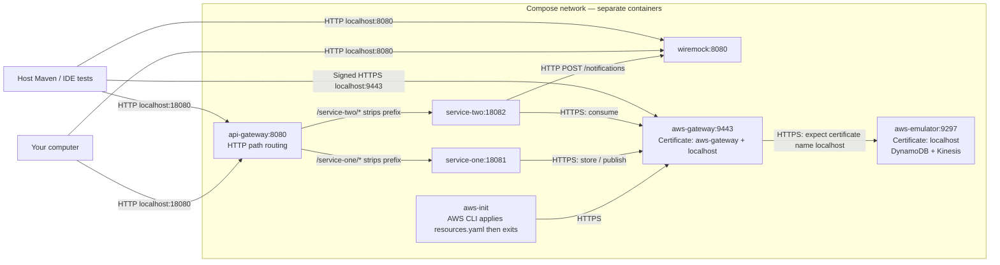
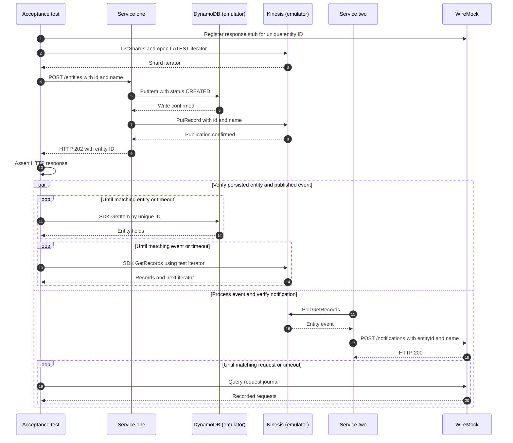

# Acceptance-test framework

A runnable example of two Spring Boot microservices and an acceptance-test framework.
The Maven modules use Spring Boot 4.1.2, AWS SDK 2.59.1, Jackson 3.3.0,
Cucumber 8.0.4, and JUnit 6.1.3. Jackson imports use `tools.jackson`; its BOM
aligns Jackson dependencies. WireMock still uses Jackson 2 internally,
so its Jackson 2 dependencies remain alongside the application's Jackson 3 libraries.
Service one receives an HTTP request, stores an entity in DynamoDB, and publishes an
event to Kinesis. Service two consumes the event and calls a third-party API, represented
by WireMock. DynamoDB and Kinesis run locally in AWS Emulator; no AWS account is needed.

Requires **Docker with Compose v2.17 or newer** and **JDK 25 or newer**. The Maven wrapper
supplies Maven 3.9.14. Application images build their own Java applications; acceptance
tests run on your computer through Maven or the IDE. AWS Emulator is pinned to **1.0.385**
in [its Dockerfile](infrastructure/aws-emulator/Dockerfile).

Run all commands below from the repository root, where `compose.yaml` lives.

## Start the stack and send a request

```sh
./scripts/init-services.sh
```

The script runs `docker compose up -d --build` and leaves the stack running. Resource
initialization runs in the one-shot `aws-init` container. It does not export host credentials
or run tests; manual requests need no host credential preparation.
Startup follows this order:

1. `aws-emulator` starts the AWS API and becomes healthy.
2. `aws-gateway` prepares certificates, starts NGINX, and becomes healthy.
3. `aws-init` applies `infrastructure/aws-init/resources.yaml` through CloudFormation,
   then exits successfully. A failed deployment blocks application startup.
4. Both microservices start. WireMock starts independently, and `api-gateway` starts
   after both application containers have started.

Resources are initialized without running any tests. Wait for service one:

```sh
curl --fail --retry 30 --retry-connrefused --retry-delay 1 \
  http://localhost:18080/service-one/ready
curl -f http://localhost:18080/service-two/ready
```

Call service two's dummy endpoint through the same host and port:

```sh
curl -fsS http://localhost:18080/service-two/hello-world
```

Expected response: `{"message":"Hello, world!"}`. This endpoint is independent of
Kinesis processing; `/service-two/ready` reports consumer readiness.

Send an entity with a unique ID. Both `id` and `name` must be nonblank:

```sh
curl -i http://localhost:18080/service-one/entities \
  -H 'Content-Type: application/json' \
  -d '{"id":"manual-001","name":"My entity"}'
```

Expected response: HTTP `202` and `{"id":"manual-001"}`. This confirms the database
write and event publication; notification processing happens asynchronously.

Read the stored entity:

```sh
docker compose run --rm aws-init dynamodb get-item \
  --table-name entities --key '{"id":{"S":"manual-001"}}' --consistent-read
```

The entity contains `id`, `name`, and `status: CREATED`. Inspect WireMock's journal:

```sh
curl -fsS http://localhost:8080/__admin/requests
```

After service two processes the event, the journal contains a `POST /notifications`
with body `{"entityId":"manual-001","name":"My entity"}`. The default stub returns
HTTP `200` with `{}`. Use a different ID for subsequent manual requests.

## HTTP routing and published ports

Each container has its own network namespace on Compose's default network. Containers
use service DNS names. All HTTP API ports are also published on host loopback so
Java tests and local tools can connect directly.

| Service | Address inside Compose | Host access | Purpose |
| --- | --- | --- | --- |
| `api-gateway` | `http://api-gateway:8080` | `http://localhost:18080` | Shared application HTTP entrypoint |
| `service-one` | `http://service-one:18081` | `http://localhost:18081` | Create entities; `/ready` |
| `service-two` | `http://service-two:18082` | `http://localhost:18082` | Consume Kinesis; `/ready` |
| `wiremock` | `http://wiremock:8080` | `http://localhost:8080` | Mock third party and admin API |
| `aws-gateway` | `https://aws-gateway:9443` | `https://localhost:9443` | Verified HTTPS access to AWS APIs |
| `aws-emulator` (raw API) | `https://aws-emulator:9297` | `https://localhost:9297` | Direct emulator debugging |

The application gateway strips the path prefix before forwarding:

| Public request | Forwarded request |
| --- | --- |
| `POST /service-one/entities` | `POST http://service-one:18081/entities` |
| `GET /service-two/hello-world` | `GET http://service-two:18082/hello-world` |
| `GET /service-one/ready` | `GET http://service-one:18081/ready` |
| `GET /service-two/ready` | `GET http://service-two:18082/ready` |

Use port `18080` for application calls. Direct service ports `18081` and `18082`
remain available for debugging. `api-gateway` handles application HTTP routing;
`aws-gateway` separately handles AWS API TLS connections.

All published ports bind to host loopback (`127.0.0.1`). Use gateway port `9443` for
normal AWS calls; raw emulator port `9297` is available for debugging with its own
certificate. Initialization runs separately in `aws-init`, which exits after provisioning.



Arrows show requests; responses return over the same connections. Raw emulator port
`9297` is also available for debugging but normal AWS clients use the gateway.
Kinesis consumption uses polling: service two sends requests to the emulator to retrieve events.

## Separate AWS services and declarative initialization

Each image has one responsibility:

| Directory | Responsibility |
| --- | --- |
| `infrastructure/aws-emulator/` | Version-pinned emulator installation |
| `infrastructure/aws-gateway/` | NGINX, certificate preparation, and Java trust-store generation |
| `infrastructure/aws-init/` | AWS CLI v2, resource template, and one-shot CloudFormation deployment |

Docker manages each long-running process directly. Gateway failure or restart leaves
emulator data intact. Its private key persists in a volume mounted only by the gateway;
public certificates persist separately so running clients continue to trust it.
Use the full reset below after restarting the emulator, whose API data is in memory.

Edit [resources.yaml](infrastructure/aws-init/resources.yaml) to declare resources:

```yaml
AWSTemplateFormatVersion: '2010-09-09'
Resources:
  Entities:
    Type: AWS::DynamoDB::Table
    Properties:
      TableName: entities
      BillingMode: PAY_PER_REQUEST
      AttributeDefinitions:
        - AttributeName: id
          AttributeType: S
      KeySchema:
        - AttributeName: id
          KeyType: HASH
  Events:
    Type: AWS::Kinesis::Stream
    Properties:
      Name: events
      ShardCount: 1
```

The template is mounted read-only, so resource changes do not require an image rebuild.
Recreate the stack to apply changes with fresh in-memory state:

```sh
docker compose down -v
./scripts/init-services.sh
```

This uses CloudFormation, not Terraform; no custom YAML interpreter is involved. The
initializer runs `aws cloudformation deploy --stack-name acceptance-demo` and waits for
completion. Failed deployment leaves `aws-init` with a nonzero exit code and blocks
application startup. Inspect `docker compose logs aws-init` for deployment errors.

To apply an edited template to a running instance without resetting data:

```sh
docker compose run --rm aws-init cloudformation deploy \
  --stack-name acceptance-demo --template-file /bootstrap/resources.yaml \
  --no-fail-on-empty-changeset
```

Changing resource names also requires updating the applications' `ENTITY_TABLE` and
`EVENT_STREAM` configuration and the demo scenario's resource names. Additional resource
types depend on the emulator's CloudFormation support; DynamoDB table and Kinesis stream
creation are exercised by this demo.

## TLS forwarding

The emulator generates a certificate for `localhost`, while containers reach it via
Docker DNS name `aws-emulator`. NGINX bridges two verified TLS connections:

1. Applications call `https://aws-gateway:9443`. Its certificate covers `aws-gateway`,
   `localhost`, and `127.0.0.1`, allowing host debugging tools to use `https://localhost:9443`.
2. NGINX connects to `https://aws-emulator:9297`, verifies its certificate against the
   expected name `localhost`, and trusts the emulator's generated CA file.

The proxy preserves the signed Host header and request body for AWS SigV4 authentication.
Applications and the initializer mount credentials and public TLS files read-only.
The Java trust-store password is the development value `changeit`. Gateway startup
reuses existing certificates; `docker compose down -v` removes them and the private key.

Restart just the proxy without resetting emulator data:

```sh
docker compose restart aws-gateway
```

## Run acceptance tests

Start the application stack and run Maven:

```sh
./scripts/init-services.sh
./scripts/prepare-host-tests.sh
./mvnw -pl acceptance-tests verify -Pacceptance
```

Acceptance tests call application HTTP endpoints using Java HttpClient, manage stubs
and verify requests using WireMock's Java client, and call DynamoDB and Kinesis using
AWS SDK clients. DynamoDB assertions use GetItem; Kinesis
assertions use ListShards, GetShardIterator, and GetRecords, reading event data through SDK byte buffers.
The test opens a LATEST iterator before creating the entity and follows subsequent
iterators until the matching event appears. This is independent of service two's consumer.

AWS SDK clients handle SigV4 authentication and use verified TLS. Each call has a
configured timeout and a single attempt; eventual assertions handle polling. The test
client factory disables CBOR (`aws.cborEnabled=false`), matching Compose, so Kinesis
uses JSON in both Maven and IDE runs. The preparation
script exports this run's credentials and public gateway trust files into
`acceptance-tests/target/host-runtime/`; it never exports private keys. Run it again after
recreating the stack. If cleaning the build, run `./mvnw -pl acceptance-tests clean`
before preparation, because clean removes these files. Do not add `clean` to the
disposable script's Maven arguments: it runs after preparation.
Defaults can be overridden with `emulator.endpoint`, `emulator.runtime`,
`emulator.credentials`, and `emulator.ca.certificate` JVM properties. The default endpoint
is `https://localhost:9443/`, region `us-east-1`. The AWS clients load the public
`ca.pem` certificate directly, without a trust-store password.

For the IDE JUnit runner, use JDK 25+, working directory `acceptance-tests/`, and
VM option `-Dacceptance.enabled=true`. Run `RunCucumberIT` to execute the Gherkin scenarios in `acceptance-tests/src/test/resources/features/`.

Local URLs can be overridden with JVM properties:

| Setting | Host default | JVM property |
| --- | --- | --- |
| Service one | `http://localhost:18080/service-one` | `service.one.base.url` |
| Service two | `http://localhost:18080/service-two` | `service.two.base.url` |
| WireMock | `http://localhost:8080` | `wiremock.base.url` |

`AcceptanceConfig` captures service URLs, emulator paths, and HTTP timeouts once per
scenario. `AcceptanceEnvironment` reuses its service clients and JSON mapper; both
service clients share an HTTP client, while AWS uses a separate client with its TLS
trust store. `ServiceOneClient` and `ServiceTwoClient` keep HTTP request construction
out of the step definitions.

The test suite waits for both service readiness endpoints and WireMock before performing
assertions. Service two reports ready only after a successful Kinesis poll. Tests use
the running service images; the test code does not start microservices or containers.

| Test | What it verifies |
| --- | --- |
| `create-entity.feature` | HTTP response, stored entity fields through the DynamoDB SDK, matching Kinesis event, and matching third-party request |
| `http-endpoints.feature` | Service-two hello response and HTTP 400 for an entity with a blank name |

Every test entity has a unique ID. Asynchronous assertions poll every **200 ms** for
at most **30 seconds per assertion**. Notification verification checks method, path,
JSON content type, and expected JSON body, and requires at least one matching request.

The sequence below shows the end-to-end test. Application requests pass through
`api-gateway` and AWS calls pass through `aws-gateway`; both proxies are omitted
here to keep the business flow readable.



The diagram groups the asynchronous outcomes; the test code verifies the database,
then the Kinesis event, then the WireMock request. Each assertion uses bounded polling.

Tests leave the stack running and do not clear manual data or WireMock history.
Test-specific stubs accumulate until WireMock stops.

For a disposable run that builds and starts the stack, runs Maven, and removes it:

```sh
./scripts/acceptance.sh
```

This script uses the **same Compose project** and removes its containers and volumes
on exit, including when setup or tests fail. It calls `init-services.sh`, then `prepare-host-tests.sh`, then Maven.
For manual requests, IDE debugging, or repeated Maven runs, use `init-services.sh`
and leave the stack running.

## Inspect resources, stubs, and logs

Run individual AWS commands without a host AWS CLI installation:

```sh
docker compose run --rm aws-init dynamodb list-tables
docker compose run --rm aws-init kinesis list-streams
```

Or enter a shell with endpoint, credentials, and certificates already configured:

```sh
docker compose run --rm --entrypoint /bin/bash aws-init
# Inside the container:
aws dynamodb scan --table-name entities
aws kinesis describe-stream --stream-name events
exit
```

Inspect WireMock stubs or clear only its request history:

```sh
curl -fsS http://localhost:8080/__admin/mappings
curl -fsS -X DELETE http://localhost:8080/__admin/requests
```

Startup stubs live in `infrastructure/wiremock/mappings/`. Tests register additional
request-specific stubs through the admin API. The request journal is in memory;
restarting WireMock clears recorded requests. Avoid clearing it while tests run.

For logs and container status:

```sh
docker compose ps -a
docker compose logs -f service-one service-two
docker compose logs api-gateway aws-emulator aws-gateway aws-init wiremock
```

`logs -f` follows output until you press Ctrl+C; it does not stop the services.

## Test reports

Cucumber runs through the JUnit Platform and Maven Failsafe. Each scenario gets its own
state and unique entity ID; failure hooks collect diagnostics. Without the acceptance
profile (or `-Dacceptance.enabled=true` in the IDE), scenarios are skipped.
HTML and JSON reports are written to `acceptance-tests/target/cucumber-reports/`.

Maven retains JUnit reports in `acceptance-tests/target/failsafe-reports/` and diagnostic
files in `acceptance-tests/target/acceptance-artifacts/`. On failure, diagnostics include
the database entity and WireMock requests when available. These files remain on your
computer even when `scripts/acceptance.sh` removes the Docker stack. `mvn clean` removes
the module's `target/` directory, including reports.

## Reset and restart

```sh
docker compose down -v
./scripts/init-services.sh
```

The emulator keeps tables, entities, streams, and records **in memory**. Stopping it
loses resource data even when the volumes remain. The volumes store credentials and
certificates, not DynamoDB or Kinesis data. WireMock's request journal is also in memory.

The emulator generates credentials and its own certificate at startup. Recreate
the complete stack after restarting it so the gateway and application clients
reload the correct files. The reset commands above also clear test-created resources.

## Project layout and configuration

| Path | Responsibility |
| --- | --- |
| `compose.yaml` | Service wiring, startup dependencies, environment, host ports |
| `service-one/` | Spring Boot HTTP → DynamoDB → Kinesis service and Dockerfile |
| `service-two/` | Spring Boot Kinesis → third-party HTTP service and Dockerfile |
| `acceptance-tests/` | Clients, fixtures, bounded polling, integration scenarios |
| `infrastructure/aws-emulator/` | Emulator image and installer |
| `infrastructure/aws-gateway/` | HTTPS proxy image and certificate preparation |
| `infrastructure/aws-init/` | One-shot AWS CLI provisioning image and CloudFormation YAML |
| `infrastructure/api-gateway/` | Shared HTTP entrypoint and service-prefix routing |
| `infrastructure/wiremock/` | Default third-party stub mappings |
| `scripts/init-services.sh` | Build/start services; AWS initialization runs in aws-init |
| `scripts/prepare-host-tests.sh` | Export emulator credentials and public TLS trust for AWS SDK tests |
| `scripts/acceptance.sh` | Automatic stack lifecycle for disposable test runs |

Both service Dockerfiles use a Maven build stage and a Java 25 runtime stage. Build
just their images with `docker compose build service-one service-two`. After changing
test code or fixtures, rerun Maven; no image rebuild is needed for acceptance tests.

Test client routing uses the JVM properties listed above, with localhost defaults.
Compose configures the application containers' AWS credentials and TLS trust.
Telemetry is disabled. The application containers use `CBOR_ENABLED=false` to keep Kinesis requests in JSON.

## Demo limits

Service one's database write and event publication are separate operations, not an
atomic transaction. Service two has a single-shard polling consumer with in-memory
progress, no durable checkpoints or rebalancing, and batch retries. Restarting service
two replays the stream from `TRIM_HORIZON`; failures can produce duplicate notifications.
The tests do not claim exactly-once delivery. Long-running failures can also exhaust
its shard iterator; this demo does not implement iterator recovery.

Use this stack to check application behavior. Emulator throughput and latency do not
establish how the services will perform against real AWS infrastructure.
